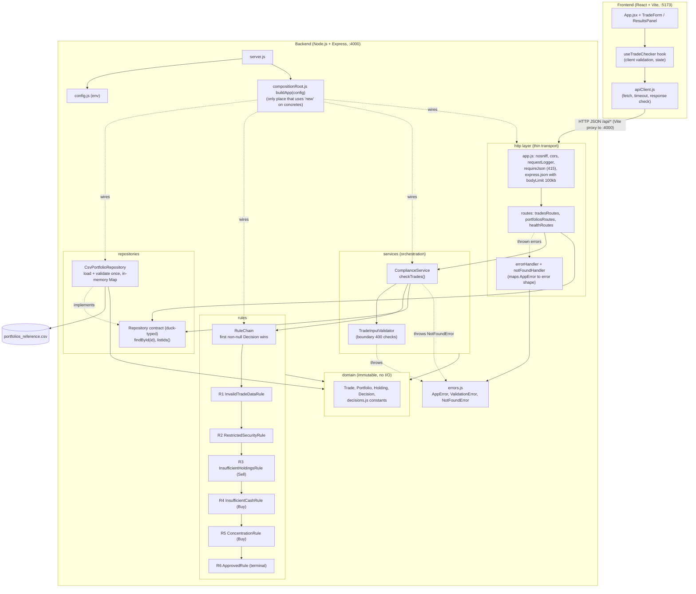
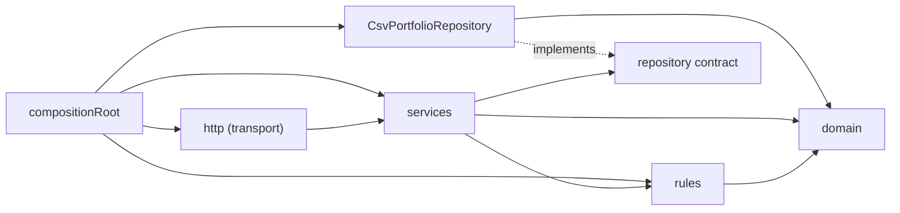

# Architecture Diagram

Reflects the code as built in `Code/backend/src` and `Code/frontend/src`.

## 1. Component view

## 2. Layers and dependency direction

Arrows point from the dependent to the dependency. `domain` depends on nothing. Business logic (rules, service) never imports `http` or the CSV class.

## 3. Notes

- **Layers**: UI to api client (single module isolating HTTP) to Express http layer to `ComplianceService` to `RuleChain` (R1 to R6) to domain. `CsvPortfolioRepository` reads the CSV once at startup; a malformed file throws `DataConfigurationError` and `server.js` exits non-zero.
- **SRP**: http only parses and serializes; `TradeInputValidator` owns boundary validation; each rule owns one check; the repository owns parsing.
- **OCP / LSP**: every rule exposes `evaluate(trade, portfolio)` returning a `Decision` or `null`. `RuleChain` has no rule-specific logic. A new rule is a new class plus one line in `defaultRules.js`, which is the single place that defines order.
- **ISP**: consumers need only `findById` and `listIds`. `portfoliosRoutes`/`healthRoutes` use `listIds`, the service uses `findById`.
- **DIP**: `ComplianceService` receives `ruleChain`, `portfolioRepository` and `tradeInputValidator` by constructor injection; `createApp` receives the service and repository. Only `compositionRoot.js` knows the concrete classes, so tests can pass a fake repository.
- **Errors**: `src/errors.js` holds the HTTP-mapped classes shared by service and http layer. `errorHandler` converts `AppError` to `{ error: { code, message, trade_index?, field? } }`; body-parser failures map to 400/413/415; anything else becomes a generic 500 with details only in logs. `bodyLimit.js` is the single source of the 100kb limit (parser option and 413 message).
- **Removed**: there is no `PortfolioRepository.js` file. The repository contract is documented in the `CsvPortfolioRepository.js` header comment (JavaScript has no interfaces).
