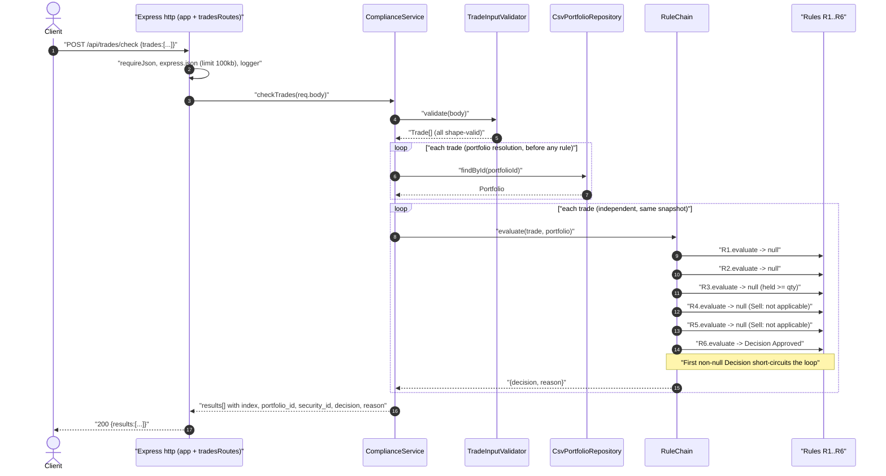
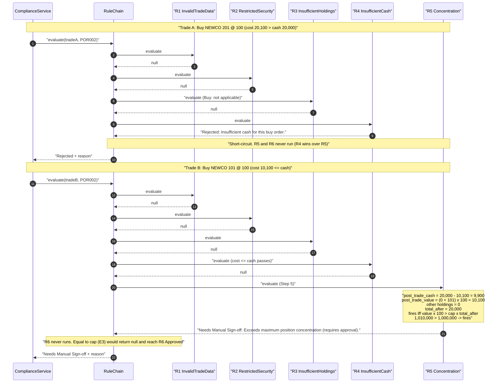
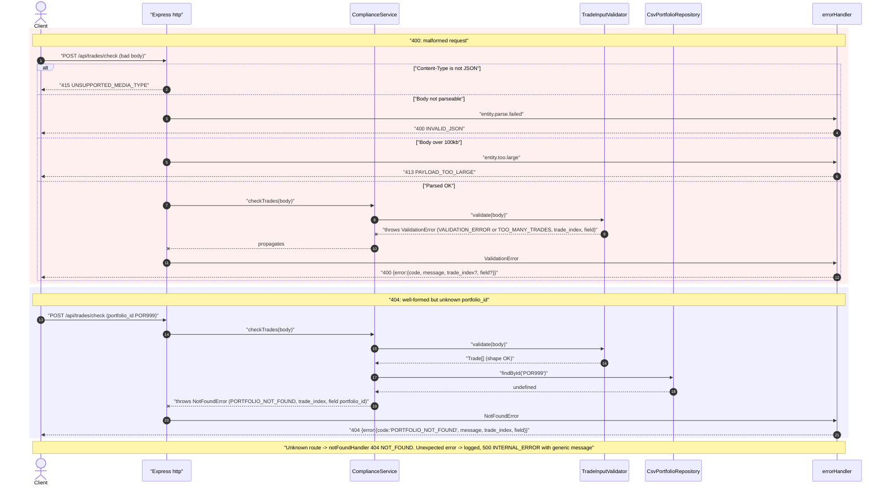
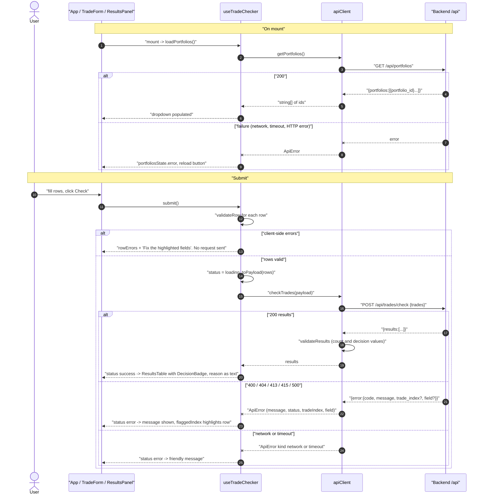

# Sequence Diagrams

Reflects the code as built. Participants: `ComplianceService` (Service), `TradeInputValidator` (Validator), `CsvPortfolioRepository` (Repo, in-memory after startup), `RuleChain` (Chain) with rules R1 to R6.

## 1. Happy path: POST /api/trades/check with rule-chain short-circuit

Example: POR001 Sell AAPL 100 (E9). R1 to R3 evaluate, R3 passes (`held == quantity`), R4 and R5 return `null` because they apply to Buy only, and the terminal R6 fires. For a trade rejected at R2 (e.g. restricted security), the chain stops there and R3 to R6 are never called.

## 2. Rejection and Needs Manual Sign-off (including Step 5)

Business outcomes are always HTTP 200. Two trades from POR002 (cash 20,000, cap 50%) are shown: a Rejected at R4 (E8) and a Needs Manual Sign-off at R5 (E4). Step 5 is reached only if R1 to R4 all return `null`.

## 3. Error paths: 400 and 404

All boundary checks run for every trade before any portfolio lookup, so a 400 anywhere in the batch wins over a 404 on an earlier trade. No rule runs and no partial results are returned.

## 4. UI: load portfolios and submit

The UI validates rows client-side first. The API client enforces a timeout, checks the response shape (decision values, result count) and converts failures to `ApiError`.

